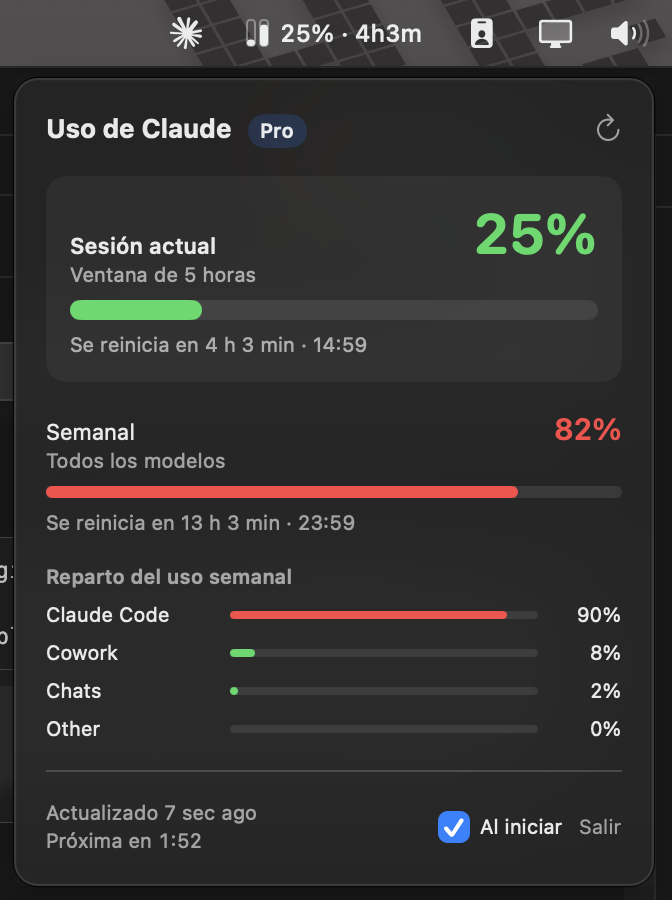
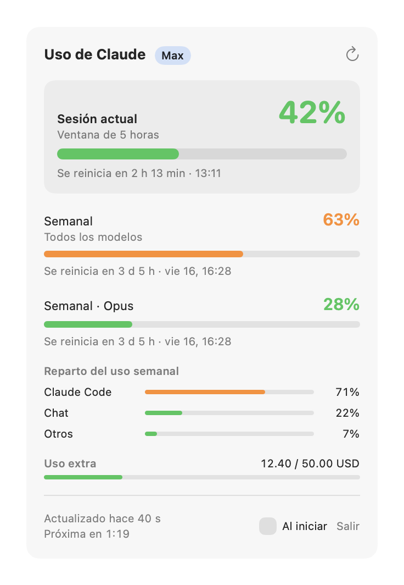
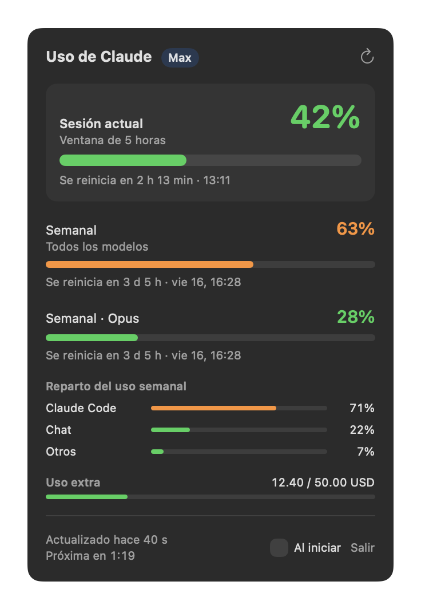

# Claude Usage — macOS menu bar app

[](https://github.com/lautisen/claude-usage-menubar/actions/workflows/ci.yml)

A lightweight native macOS menu bar app that shows your **Claude plan usage limits** in real time: the current 5‑hour session, the weekly limit, per‑model weekly limits and extra usage — with countdowns to each reset.

> 🇪🇸 App nativa para la barra de menús de macOS que muestra en tiempo real el uso de los límites de tu plan de Claude (sesión de 5 h, semanal, por modelo y uso extra). La interfaz está en español.

<p align="center">
  
</p>

## Features

- **Menu bar indicator** — a custom two‑bar icon (5‑hour session + weekly) plus the session percentage and time until reset, e.g. `42% · 2h13m`. Turns orange at 75 % and red at 90 %.
- **Dropdown panel** with:
  - Current session (5‑hour window) with a live countdown and reset time
  - Weekly limit (all models) and per‑model weekly limits (Opus / Sonnet) when present
  - Breakdown of weekly usage by category
  - Extra usage credits vs. monthly limit, when enabled
- **Auto‑refresh** every 2 minutes, plus refresh on open if data is older than 30 s; visible countdown to the next refresh.
- **Launch at login** toggle (via `SMAppService`).
- No Dock icon (`LSUIElement`), no third‑party dependencies.

### Light & dark mode

<p align="center">
  
  
</p>

## How it works

The app reuses the OAuth session that [Claude Code](https://claude.com/claude-code) already stores in the macOS Keychain (`Claude Code-credentials`), read through `/usr/bin/security` so no extra permission prompts appear. It then calls the usage endpoint that Claude Code itself uses (`/api/oauth/usage`) and decodes the response.

Your token never leaves your machine except in the request to `api.anthropic.com`.

## Requirements

- macOS 14 (Sonoma) or later, Apple Silicon
- Xcode Command Line Tools (`xcode-select --install`)
- Claude Code installed and logged in with a Claude subscription (`claude` → `/login`)

## Download

Grab `ClaudeUsage.zip` from the [latest release](https://github.com/lautisen/claude-usage-menubar/releases/latest), unzip it and move `ClaudeUsage.app` to `~/Applications` or `/Applications`.

The app is ad‑hoc signed (not notarized), so macOS will block it on first launch. Either right‑click it → **Open** → **Open**, or run:

```sh
xattr -dr com.apple.quarantine ~/Applications/ClaudeUsage.app
```

## Build from source

```sh
git clone https://github.com/lautisen/claude-usage-menubar.git
cd claude-usage-menubar
./build.sh            # builds build/ClaudeUsage.app
./build.sh install    # also copies it to ~/Applications and launches it
```

The build uses `swiftc` directly (no Xcode project) and ad‑hoc signs the bundle.

## Tests

The project is a Swift package with a test suite written in [Swift Testing](https://developer.apple.com/documentation/testing):

```sh
swift test
```

> With only the Command Line Tools installed (no Xcode), you may need to point the compiler to the testing macros:
> `swift test -Xswiftc -plugin-path -Xswiftc /Library/Developer/CommandLineTools/usr/lib/swift/host/plugins/testing`

What is covered:

- **Networking** — `fetch()` end to end against a stubbed `URLProtocol`: auth headers, HTTP status → error mapping (401/403/429/5xx), and that no request is made without credentials.
- **Parsing** — Keychain credential JSON (valid and malformed), a realistic API response with `null` windows and unknown fields, and ISO 8601 dates with microsecond fractions.
- **State** — `UsageStore` refresh with an injected fetcher: publishing data, keeping the last good data on error, recovering, and the staleness rule.
- **Formatting** — countdowns, reset times (fixed time zone), menu bar title and color thresholds, using parameterized tests.

CI runs the tests and builds the app bundle on every push and pull request.

## Project structure

| File | Responsibility |
| --- | --- |
| `Sources/ClaudeUsage/main.swift` | App delegate, status item, custom dropdown panel (`NSPanel`) and the menu bar icon drawing |
| `Sources/ClaudeUsage/UsageStore.swift` | Observable state, refresh scheduling, launch‑at‑login; the fetcher is injected for testing |
| `Sources/ClaudeUsage/UsageService.swift` | Keychain credential lookup, API request, status handling and `Decodable` models |
| `Sources/ClaudeUsage/Formatting.swift` | Pure formatting and threshold logic shared by the menu bar and the dropdown |
| `Sources/ClaudeUsage/PopoverView.swift` | SwiftUI views for the dropdown |
| `Tests/ClaudeUsageTests/` | Swift Testing suites |
| `build.sh` | Compiles and packages the `.app` bundle |

### Implementation notes

- **Custom panel instead of `NSPopover`**: `NSPopover` would partially render above the top edge of the screen when its content resized. A borderless `NSPanel` positioned manually always stays inside the visible frame and repositions itself as the SwiftUI content grows.
- **Date parsing**: the API returns microsecond fractions, which `ISO8601DateFormatter` rejects, so fractions are stripped before parsing.
- **Timeline‑driven UI**: countdowns use SwiftUI `TimelineView` so they tick without extra network requests.

## Disclaimer

This is an unofficial personal project, not affiliated with or endorsed by Anthropic. It relies on an undocumented endpoint that may change or stop working at any time.

## License

[MIT](LICENSE)
